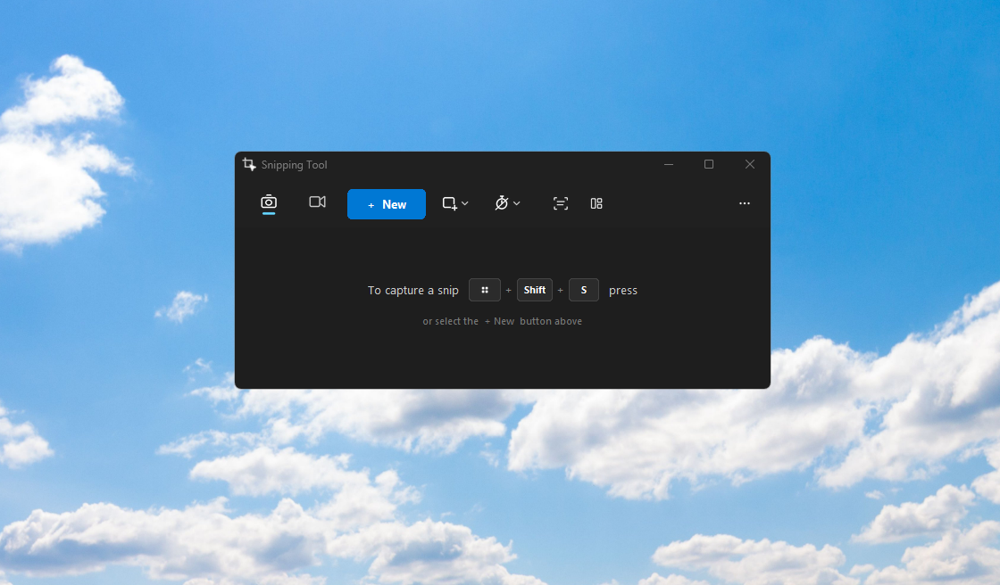
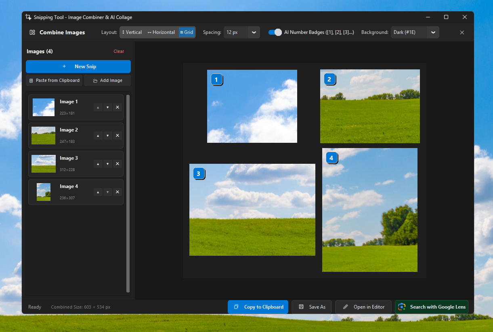
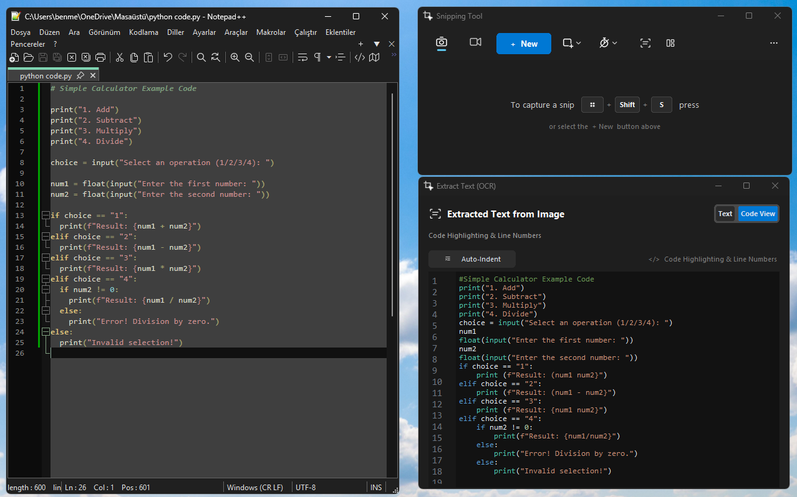
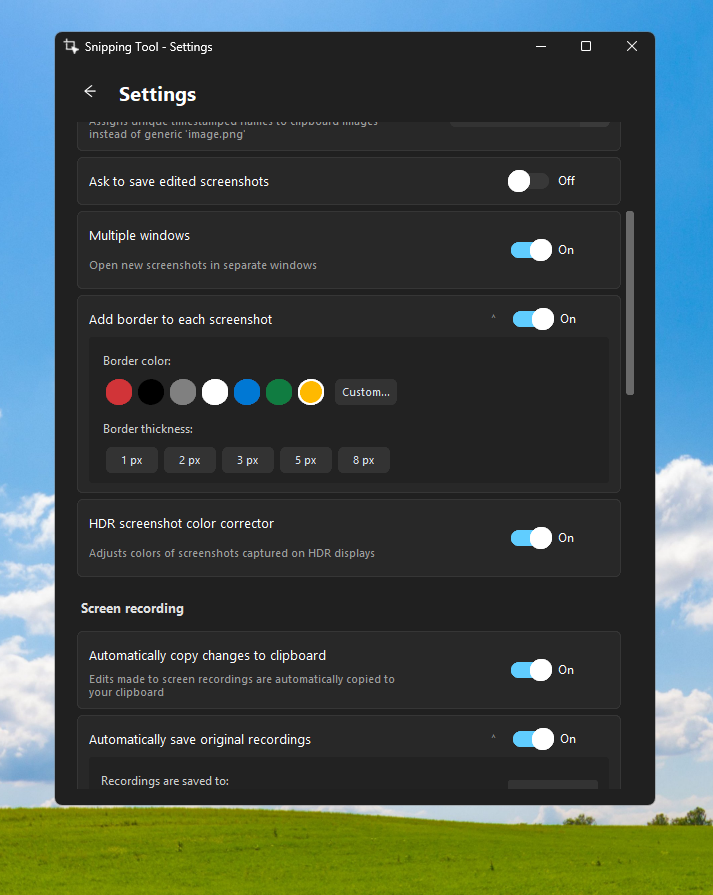

<p align="center">
  
</p>

<h1 align="center">Snipping Tool (Google Lens & AI Multi-Image Combiner)</h1>

<p align="center">
  <strong>A modern, high-performance Windows 11 Snipping Tool alternative featuring direct Google Lens visual search, AI multi-screenshot collage stitching (optimized for LLMs), OCR code extraction with syntax highlighting, screen video recording, and native Windows system integration.</strong>
</p>

<p align="center">
  <a href="README.md"><b>English</b></a> | 
  <a href="README_TR.md"><b>Türkçe</b></a>
</p>

<p align="center">
  
  
  
  
  
  
</p>

---

## 📸 Interface Showcase

<p align="center">
  
  
</p>
<p align="center">
  
  
</p>

---

## 📖 Overview

Windows 11's built-in **Snipping Tool** locks visual search strictly to **Microsoft Bing** with no user setting or registry key to change your default search engine to Google.

**Snipping Tool** is a high-performance, open-source desktop utility authored by **Meriç Yüzaklı**. Developed through reverse engineering the Windows 11 Snipping Tool binaries, this application eliminates Bing lock-in by uploading captures directly to the official **Google Lens** web API.

In addition, it introduces groundbreaking developer and AI productivity features missing from the native OS:
- **Multiple Screenshot Merger for AI & Vision Models:** Consolidates multiple screen captures into a unified token-optimized canvas stamped with reference badges.
- **Smart OCR & Code View:** Scans text from screen regions and formats programming code with syntax highlighting, line numbers, and 1-click auto-indentation.
- **Native Windows Protocol Handler:** Deeply registers as the default `ms-screenclip:` handler and intercepts `PrtScn` / `Win+Shift+S`.
- **Hardware-Accelerated Screen Video Recording:** Smooth area recording with microphone and system audio loopback.

---

## 🧩 Multiple Screenshot Merger for AI & Vision Models

This feature allows users to capture multiple screenshots consecutively and merge them into a single, unified canvas before sending them to AI Vision models (such as **GPT-4o**, **Claude 3.5 Sonnet**, or **Gemini 1.5 Pro**).

<p align="center">
  
</p>

### 🚀 Key Advantages & AI Benchmarks

#### 1. Massive Token & Cost Savings (Base Token Optimization)
Vision LLMs charge a hefty fixed **"Base Token"** price for every single image file uploaded, regardless of its resolution, plus additional tokens for high-resolution tiles.
- **The Problem:** Uploading 5 separate screenshots forces the AI to process the base token overhead 5 separate times.
- **Our Solution:** By stitching 5 screenshots into 1 single canvas, the AI only processes the base token **exactly once**. This cuts down initial token consumption dramatically, lowering API costs and saving valuable context window space.

#### 2. Bypass UI Upload Limits
Most LLM chat interfaces (like ChatGPT, Claude.ai, or custom enterprise portals) enforce strict limits on the number of attachments permitted per individual prompt (e.g., maximum 4 or 5 images). This tool effortlessly bypasses those constraints by consolidating **10+ visual steps into a single unified image file**.

#### 3. Superior Spatial & Contextual Understanding
When images are uploaded separately, Vision models can lose the chronological flow or spatial relationships between them.
- **Chronological Workflows:** Perfect for step-by-step bug reporting (`Step [1] -> Step [2] -> Step [3]`).
- **Side-by-Side Comparisons:** Perfect for UI/UX audits, code diff comparisons, or design-to-code translations, allowing the AI to seamlessly reason between *"the left panel [1]"* and *"the right panel [2]"*.

### 🛠️ Built-in Stitching Features

| Feature | Description |
| :--- | :--- |
| **Flexible Layout Engine** | **Vertical stack** (top-to-bottom), **Horizontal strip** (side-by-side), or **Grid** (automatic square configuration). |
| **Auto-Numbering Badges `[1]`, `[2]`** | Automatically overlays subtle, high-contrast numeric badges on each screenshot, enabling precise prompting (e.g., *"Analyze the error shown in step 3"*). |
| **Custom Spacing & Backgrounds** | Customizable inter-image gap spacing and background themes (`Dark #1E1E1E`, `Pitch Black #000000`, `Pure White #FFFFFF`, `Neutral Gray #333333`). |
| **Instant Export** | One-click **Copy to Clipboard** (`Ctrl + C`), **Save As Image** (`Ctrl + S`), or **Open in Editor** for drawing annotations. |

---

## 🔤 Smart OCR & Code Extraction with Syntax Highlighting

Capturing code from editors, documentation, videos, or terminals now takes a single click:

- **1-Click Text Scan from Main Bar:** Click the OCR scan icon (`🔍`) on the compact toolbar to drag and crop any text or code on screen.
- **Automatic Code Detection:** Intelligently recognizes code patterns (Python, JavaScript, C/C++, HTML, etc.) and opens directly in **Code View**.
- **Line Numbers & Synced Scrolling:** Gutter line numbers that scroll smoothly with the editor.
- **VS Code-Style Syntax Highlighting:** Keywords, strings, comments, numbers, and functions are color-coded in real time.
- **🪄 1-Click Auto-Indent (`Girintileri Düzenle`):** Automatically reconstructs hierarchical code indentations (`:` and `{}`) flattened or damaged by OCR scanning.
- **Clean Code Copying:** Copies clean formatted code directly to your clipboard without line number prefixes.

---

## ✨ Full Feature Matrix

| Feature | Description |
| :--- | :--- |
| 🔍 **Direct Google Lens Search** | Bypasses Bing lock-in. Uploads captures directly to the official Google Lens web endpoint and opens results in your default browser with zero third-party hosts. |
| 🧩 **AI Image Combiner & Collage** | Merge multiple screenshots vertically, horizontally, or in a grid with numbered `[1]`, `[2]`, `[3]` badges for LLM prompt precision. |
| 🔤 **OCR Code & Text Extractor** | Extract text or code with real-time syntax highlighting, line numbers, and intelligent auto-indent formatting. |
| ⚡ **Native Windows Default Tool** | One-click setup as the system default. Seamlessly intercepts `PrtScn`, `Win+Shift+S`, and the native Windows `ms-screenclip:` protocol without requiring administrator privileges. |
| 🖥️ **Desktop Shortcut Integration** | Instantly create a branded Windows shortcut (`.lnk`) with the custom multi-resolution application icon on your desktop from settings or the toolbar. |
| 🚀 **Run on Windows Startup** | Silently initializes in the background on system boot (`--startup`) with a lightweight system tray daemon and 0% idle CPU utilization. |
| 🎥 **Area Video Recording with Audio** | High-definition area video recording supporting both microphone and system loopback audio, highlighted by a live reactive border. |
| 📋 **Conflict-Free Smart Clipboard** | Multi-format clipboard support (`CF_HDROP`, `CF_PNG`, `CF_DIB`) with millisecond timestamps to prevent image name collisions when pasting into web applications. |
| 🎨 **Windows 11 Fluent Design** | Sleek acrylic glassmorphism, Dark & Light modes, drawing tools (Pen, Alpha Highlighter, Eraser), custom border styling, and delay timers (3s, 5s, 10s). |
| 🌐 **Multilingual Interface (i18n)** | Available in English, Turkish, German, Spanish, French, and Russian with instant runtime language switching. |

---

## 🔍 Reverse Engineering Findings

An analysis of the native Windows 11 Snipping Tool binaries (`SnippingTool.Net.RuntimeComponent.dll` and `SnippingToolUI.dll`) revealed the following architectural constraints:

1. **Hardcoded Bing Endpoint:**
   - Source path: `/_/src/SnippingTool.Net.Core/Services/VisualSearchService.cs`
   - Internal API: `https://www.bing.com/images/search?view=detailv2&iss=sbiupload&FORM=SBISNP&sbisrc=ImgPicker&idpbck=1`
   - The native application hardcodes an HTTP POST directly to Bing's visual search server and triggers Microsoft Edge via `Windows.System.Launcher.LaunchUriAsync`. There is no configuration option or registry flag to alter this target.

2. **Google Lens Web API Interfacing:**
   - Captured images are transmitted via `multipart/form-data` with the `encoded_image` parameter to `https://lens.google.com/v3/upload`.
   - The Google endpoint responds with an immediate **HTTP 303 See Other**, providing the visual search results URL (`https://www.google.com/search?vsrid=...`) in the `Location` header.
   - **Privacy Guarantee:** Images are transmitted over TLS directly to Google's official endpoints without passing through any third-party image hosting service (Imgur, Catbox, etc.).

---

## 📊 Comparison with Microsoft Snipping Tool

| Capability | Microsoft Snipping Tool | This Open-Source Tool |
| :--- | :---: | :---: |
| **Visual Search Provider** | ❌ Bing Only (Locked) | ✅ **Google Lens (Direct)** |
| **AI Multi-Image Combiner** | ❌ Not available | ✅ **Vertical, Horizontal, Grid** |
| **AI Reference Badges `[1]`, `[2]`** | ❌ Not available | ✅ **Automatic Numbered Badges** |
| **OCR Code View & Auto-Indent** | ❌ Plain text only | ✅ **Syntax Highlighted & Line Numbers** |
| **System Protocol Override** | Default UWP | ✅ **Native `ms-screenclip:` Handler** |
| **Hardware Audio Video Recording** | Basic | ✅ **Mic + System Loopback Audio** |
| **PrtScn Global Interception** | Default Windows hook | ✅ **Sub-20ms Suppressed Hook** |
| **Single-Instance IPC Daemon** | UWP Process | ✅ **Local Loopback Socket IPC** |
| **Source Code & Customization** | ❌ Proprietary | ✅ **100% Open Source (MIT)** |

---

## 🚀 Installation & Quick Start

### 1. Prerequisites
- Windows 11 or Windows 10 (64-bit)
- Python 3.10 or higher

### 2. Clone the Repository
```bash
git clone https://github.com/benmeric/snipping-tool.git
cd snipping-tool
```

### 3. Install Dependencies
```bash
pip install -r requirements.txt
```

### 4. Launch Application
- **Standard UI Launch:**
  ```bash
  python main.py
  ```
  *(or double-click `Start.bat` / `SnippingTool.bat`)*

- **Silent Background Launch (System Tray):**
  Double-click `StartBackground.vbs` to run silently in the background without opening a terminal window.

---

## ⚡ Windows System Integration

To set this tool as your default screen capture utility:
1. Open the application and navigate to **Settings** (`Ctrl + ,` or click the `...` menu).
2. Under **Shortcuts & System**, toggle **Set as Default Snipping Tool** to **ON**.
3. Toggle **Start with Windows** to **ON** to ensure the tool is ready immediately upon logging into Windows.
4. Click **Add to Desktop** to place a branded shortcut on your desktop.

> **How it works:**  
> The tool registers itself in `HKEY_CURRENT_USER\Software\Classes\ms-screenclip` and `RegisteredApplications`. When `PrtScn`, `Win+Shift+S`, or a hardware pen button triggers a screen clip, Windows delegates the event to this application. If an instance is already running, an IPC signal triggers the capture overlay in under 20 milliseconds without spinning up redundant processes.

---

## ⌨️ Keyboard Shortcuts

| Shortcut | Action |
| :--- | :--- |
| **`PrtScn`** or **`Win + Shift + S`** | Take a screen snip (Rectangle, Window, Full Screen, Freeform) |
| **`Ctrl + Shift + S`** | Take a photo snip |
| **`Ctrl + Shift + R`** | Start area screen video recording |
| **`Ctrl + G`** | Search current capture in Google Lens |
| **`Ctrl + C`** | Copy capture to clipboard |
| **`Ctrl + S`** | Save image to disk |
| **`Ctrl + Z`** | Undo drawing action |
| **`Ctrl + ,`** | Open Settings panel |
| **`+`** or **`Numpad +`** | Trigger new snip or recording |
| **`ESC`** | Cancel active overlay |

---

## ⚙️ Configuration (`config.json`)

Settings can be customized directly in the graphical UI or by modifying `config.json`:

```json
{
    "app_theme": "dark",
    "app_language": "en",
    "google_lens_enabled": true,
    "is_default_snipper": true,
    "intercept_print_screen": true,
    "auto_copy_snip": true,
    "auto_save_snip": true,
    "snip_filename_prefix": "Screenshot",
    "record_mic_default": false,
    "record_system_audio_default": true,
    "add_border": false,
    "hdr_color_fix": false,
    "play_sound": true,
    "show_toast_notification": true
}
```

---

## 📜 License

This project is licensed under the **MIT License** — see the [LICENSE](LICENSE) file for details.

Developed with ❤️ by **Meriç Yüzaklı**
